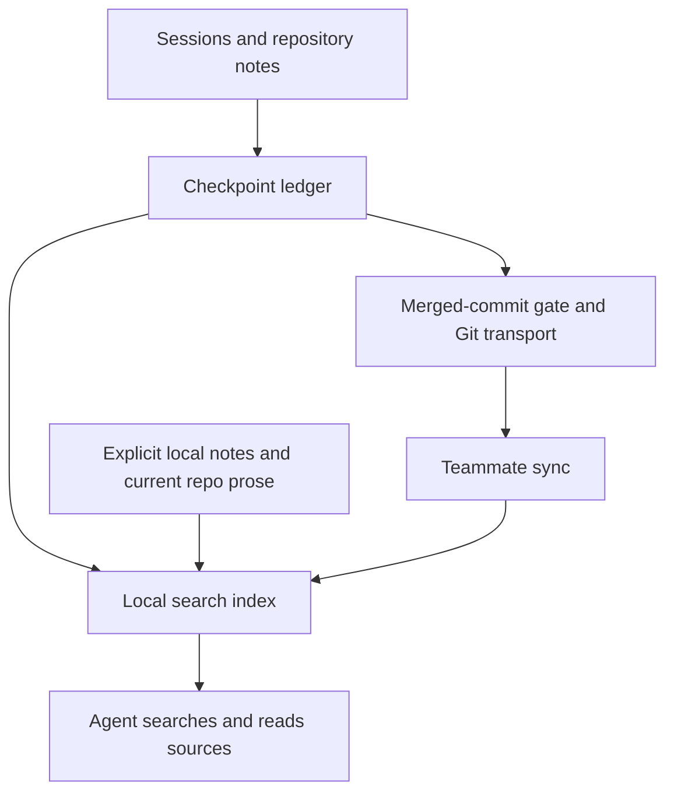

# Rekal

> This page describes the current main branch. Native memory integration,
> literal search pagination and `query --ref` are unreleased changes; the
> v1.0.2 installation does not include them. See the [changelog](CHANGELOG.md) for release status.

**Carry the reasoning forward.**

Rekal gives your coding agents a shared record of decisions, rejected approaches
and project memory, linked to the code they helped create. Find the relevant
context, read the original evidence, and continue the work across sessions,
agents and teammates.

Capture at commit time. Search locally. Share eligible context through Git.
No hosted memory service required.

[](https://rekal.dev)
[](https://github.com/rekal-dev/rekal-cli/releases)
[](https://github.com/rekal-dev/rekal-cli/actions/workflows/ci.yml)
[](https://arxiv.org/abs/2607.14390)
[](LICENSE)
[](https://discord.gg/hDMj8zHH2)
[](https://github.com/rekal-dev/rekal-cli/stargazers)

[Quick start](#quick-start) · [Commands](#commands-reference) · [How it works](#how-it-works) · [Team memory](#team-memory) · [Benchmarks](#benchmarks) · [Docs](#documentation) · [Paper](https://arxiv.org/abs/2607.14390) · [Discord](https://discord.gg/hDMj8zHH2)

## Why Rekal

Your next agent should be able to recover why the code looks this way, what was
already tried, and which constraints still matter. Rekal preserves captured
conversation text alongside Git checkpoints and makes it searchable on demand.

- **Continue earlier work:** find decisions and rejected alternatives before
  repeating the investigation.
- **Follow the evidence:** read attributed passages and associated commits;
  native memory notes remain identifiable as notes.
- **Share through Git:** repository context follows the merged-commit export
  gate. Personal sources explicitly configured as local stay in the local index.
- **Keep control:** local embeddings by default, a rebuildable search index and
  no required memory service. Optional remote embeddings are explicit configuration.

Session capture supports Claude Code, Cursor, Copilot, Codex, Gemini, Kiro and
OpenCode. Native note discovery currently defaults to **Claude project memory**;
other Markdown note sources need configuration. These are different capabilities.


### Works with the memory you already use

Agent notes are useful working context. Rekal can preserve repository note
revisions and retrieve them alongside the conversations; it does not replace the
agent's note-writing process or write back to its native files. The agent chooses
what evidence to read and what to conclude.

Git remains the transport and commit anchor. A merged commit makes associated
records eligible for sharing; it does not prove that every captured statement is
about merged work. Read the [sharing boundaries](docs/design/native-memory.md)
before enabling repository capture for additional sources.

## Quick start

**Requirements:** git, and macOS on Apple Silicon or Linux (x86-64 / arm64).
Nothing else — no runtime, no Python, no API key, no service to run.

> **Published baseline: v1.0.2.** The store format, wire format, command surface and exit
> codes are covered by the version number, and breaking any of them now
> requires a major version. [docs/compatibility.md](docs/compatibility.md)
> states exactly what that covers and what it deliberately does not —
> ranking and `index.db` stay unfrozen so retrieval can keep improving.

The binary is **~170 MB** to download and **~200 MB** on disk. That is the
tradeoff for a single file: the inference engine, the embedding model, the
database, and the full-text extension all ship inside it, so there is no model
download on first run, no service to start, and recall works offline.

### From Claude Code

```
/plugin marketplace add rekal-dev/rekal-cli
/plugin install rekal@rekal-dev
```

Then `/rekal:install` once per machine, and `/rekal:init` in each repo you want
memory in. Both confirm before touching anything. That's the whole setup — skip
to step 3 below.

### From a shell

```bash
# 1. Install (into ~/.local/bin)
curl -fsSL https://raw.githubusercontent.com/rekal-dev/rekal-cli/main/scripts/install.sh | REKAL_VERSION=v1.0.2 bash

# 2. Turn it on in your repo
cd your-project
rekal init

# 3. Work as normal — commit, and your AI session is captured automatically
git commit -m "…"

# 4. In any later session, ask
rekal "why did we drop batching?"
```

<details>
<summary>Other ways to install</summary>

**Read the script before running it** — same result, nothing piped into a shell:

```bash
curl -fsSL https://raw.githubusercontent.com/rekal-dev/rekal-cli/main/scripts/install.sh -o rekal-install.sh
less rekal-install.sh
REKAL_VERSION=v1.0.2 bash rekal-install.sh
```

**Download the binary yourself** from
[Releases](https://github.com/rekal-dev/rekal-cli/releases/latest) —
`rekal_darwin_arm64.tar.gz`, `rekal_linux_amd64.tar.gz`, or
`rekal_linux_arm64.tar.gz`. Each release ships `checksums.txt`; verify with
`shasum -a 256 -c checksums.txt`, then extract `rekal` onto your `PATH`.

**Install somewhere else** with `--target <dir>`. Piping into a shell needs
`-s --` before it, because the flags are for the script, not for bash:

```bash
curl -fsSL https://raw.githubusercontent.com/rekal-dev/rekal-cli/main/scripts/install.sh | REKAL_VERSION=v1.0.2 bash -s -- --target /usr/local/bin
```

**Choose a different version** by changing `REKAL_VERSION`, or drop it to take
whatever is newest:

```bash
curl -fsSL https://raw.githubusercontent.com/rekal-dev/rekal-cli/main/scripts/install.sh | bash
```

Without it the installer looks the newest release up over the network. The
commands above name a version because that lookup is the one step that can fail
on a network you do not control — a shared office IP can exhaust GitHub's 60
unauthenticated API calls an hour, and some proxies allow `github.com` but not
`api.github.com`. A named version skips the lookup entirely.

`REKAL_VERSION` has to go in front of the command that runs the *script*. In
front of `curl` it applies to the download and never reaches the script, which
then resolves the newest version anyway.

**Build from source** if you want to change it. `go install` alone will not
work, because the deep-embedding layer is CGO bound to a pinned llama.cpp
build. Follow [docs/DEVELOPMENT.md](docs/DEVELOPMENT.md), which has the exact
prerequisites (mise, git-lfs, cmake, the pinned llama.cpp tag).

</details>

`rekal init` sets up `.rekal/` (the store), a `post-commit`/`pre-push` git hook,
the agent skill under `.claude/skills/rekal/`, an **orphan branch**
`rekal/<your-email>` for transport (a branch with no common ancestor with your
code, so it never touches your history, merges, or working tree), and one
marker-tagged line in `CLAUDE.md`
pointing your agent at the skill — plus the equivalent line in the rules file of
any other agent it detects (`AGENTS.md` for Codex/Cursor/OpenCode, `GEMINI.md`,
`.github/copilot-instructions.md`, or `.kiro/steering/rekal.md` for Kiro). Your
own content is never touched. That
line is the whole developer experience for most users: init, then commit and
push as normal — your agent routes its own memory from there.

After you upgrade the binary, the next recall that sees a pinned skill-version
mismatch refreshes `.claude/skills/` in place (hooks and agent instruction
files are left alone). Re-run `rekal init` to also refresh hooks, the CLAUDE.md
marker line, and other detected-agent rules — data stays untouched.

To back Rekal out of a repo, run `rekal clean`. It asks first, then removes the
store, both git hooks, the installed skill, and the marker line from every agent
rules file it wrote — deleting a rules file it created and leaving one you
already tracked. Two things it deliberately does not touch: a `.gitignore` it
added entries to, and the local transport branch `rekal/<your-email>` (a git ref
is yours to delete — `git branch -D rekal/<your-email>`). To remove the binary
itself, delete it from wherever you installed it (default `~/.local/bin/rekal`)
along with `~/.config/rekal/` if you created a global config. Full setup,
teardown, and verification detail: **[docs/usage.md](docs/usage.md)**.

The Claude Code plugin above is setup only — `/rekal:install` and `/rekal:init`,
plus the installer it ships. The recall skill itself comes from the binary, so it
always matches the version answering your commands.

## See it in action

A decision was settled in an earlier session: webhook retries use exponential
backoff, not a fixed delay. A later agent — different session, no memory of that
— is about to propose the fixed delay again. It asks first.

The basic interaction is **search, then read**. This example describes the
unreleased main-branch interface; install from source to try it today.

```bash
rekal "should webhook retries use a fixed delay?"
```

Search returns ranked conversation leads, matching memory notes, current prose
pointers and a paginated list of literal conversation matches. Conversation and
memory results carry a copyable read command:

```bash
rekal query --ref <returned-reference>
```

Follow the printed `more:` command for another page. Search continuations use
`rekal --cursor`; source-read continuations use `rekal query --cursor`. Add
`--json` to either command for structured output.

The agent can recover both the decision and why alternatives were rejected.
A reference identifies the source, not a generated answer. Notes can contain
mistakes; a historical decision is not proof of current code behavior.

`INJECT`, `KNOWLEDGE` and `SILENCE` describe ranked recommendations. Literal and
memory blocks can still provide useful sources. Short handles such as `s14` are
local conveniences; keep the canonical reference for durable citations. A
ranked result's default reference opens its first anchor; advanced `rekal evidence`
can combine multiple anchors. See [the read contract](docs/spec/command/query.md).

## Commands reference

The everyday read path matches the installed agent skill:

| Task | Command |
|---|---|
| Find relevant context | `rekal "<query>"` |
| Read a returned source | `rekal query --ref <reference>` |
| Read more | Follow the returned `more:` command |
| Structured output | Add `--json` |

Setup and sharing: `rekal init`, normal commits/pushes, and `rekal sync` for
teammate context. See [usage](docs/usage.md) for storage and sharing boundaries.

<details>
<summary>Advanced filters, administration and SQL</summary>

| Command | Description |
|---------|-------------|
| `rekal init` | Initialize Rekal in the current git repository |
| `rekal clean` | Remove Rekal setup from this repository |
| `rekal version` | Print the CLI version |
| `rekal checkpoint` | Capture the current session after a commit |
| `rekal push [--rebuild]` | Push Rekal data to the remote branch (merged work only; append-only — no force) |
| `rekal sync [--self]` | Sync team context from remote rekal branches |
| `rekal index [--include-all\|--include <repo>\|--no-local]` | Rebuild the index DB (atomic temp→rename); optionally fold in cross-repo local sessions |
| `rekal embed` | Fill missing semantic embeddings (resumable; also started after index/sync) |
| `rekal log [--limit N]` | Show recent checkpoints |
| `rekal find "<term>" [role]` | Advanced unpaged literal matching-turn sweep, ordered by time |
| `rekal [--file <re>] [--commit <sha>] [--author <email>] [--actor human\|agent] [-n N] [--explain] [--json] [query]` | Hybrid search plus paginated literal conversation matches; `--json` for raw structured results; `--explain` adds per-layer scores |
| `rekal query --ref <reference> [--json]` | Read a conversation, passage or memory note; follow the returned continuation |
| `rekal --cursor <cursor>` / `rekal query --cursor <cursor>` | Continue search matches / source reading |
| `rekal query --session <id> [--role <r>] [--offset N] [--limit N] [--full] [--json]` | Drill into a session — readable turns by default; `--json` for one object |
| `rekal query --sql "<sql>" [--index] [--json]` | Raw SQL → TSV by default; `--json` for NDJSON |

These tools are available when the task needs them. SQL is for explicit
analysis/debugging; it is not required to use memory. `rekal find` and
`rekal evidence` remain advanced interfaces. The basic path is search/read.

</details>

Full details: [docs/commands.md](docs/commands.md) and
[per-command specs](docs/spec/command/).

## What makes Rekal different

- **Git-linked context.** Captured conversations and repository note revisions
  are anchored to commits and transported on dedicated Git branches.
- **Original evidence remains available.** Rekal does not replace captured turns
  with generated summaries. Existing agent notes are additional, attributed sources.
- **Local retrieval by default.** Full-text search and embedded semantic models
  run locally. An explicitly configured HTTP embedding endpoint receives text.
- **One binary, on-demand reads.** No separate database service; search returns
  leads and bounded reads fetch source text as needed.
- **Personal recall signals.** Local reach/drill hints describe your prior use;
  they are never published as team conversation history.

The design principles are in [SOUL.md](SOUL.md).

## Team memory

This is the payoff: your team's reasoning, shared without a server. Rekal data
rides plain git on orphan branches named `rekal/<email>` — no common ancestor
with your code, so it never touches your history, merges, or working tree.

- **`rekal sync`** fetches teammates' branches and folds their sessions into
  your local index — team context before you start working.
- **Merged work only.** Your local store keeps *every* branch at full fidelity,
  but only work that **landed on the default branch** reaches the wire (ancestor
  of `main`, or a squash-merge detected by patch-equivalence — no heuristics).
  Unmerged spikes stay local; a dead-end never leaks to the team, and merged
  work ships automatically on the next push.
- **Cross-repo recall (optional)** can span every local session on your machine,
  index-only so it's structurally unshareable.
- **Redacted before storage.** Every transcript runs through secret redaction
  (pattern matching plus a Shannon-entropy check for high-entropy tokens) and
  home-directory path anonymization *before* it is written to `data.db` — so
  the scrub happens once, at capture, and nothing unscrubbed can reach the
  wire later. It is best-effort pattern matching, not a proof: a redaction
  miss is a security issue we want reported, and if a secret does land in the
  ledger, **rotate the credential first** — see [SECURITY.md](SECURITY.md) for
  the remedy and the threat model.

Team memory includes eligible captured conversations and repository note revisions. The recall graph is separate:
personal and local — it adapts to *your* access patterns and never rides the
wire. Full workflow: **[docs/usage.md](docs/usage.md)**.

## Knowledge layer

Recall isn't only past sessions. Rekal also chunks your repo's prose at HEAD
(`README`, `docs/`, design notes) into a **knowledge** substrate, so a question
about a current convention returns a pointer to the authoritative file and lines
rather than an old conversation — the `KNOWLEDGE` verdict in the digest above.

The digest holds knowledge hits to a relevance floor, so on a repo with only a
file or two of prose a match can score below it and you'll get `SILENCE` where
you expected `KNOWLEDGE`. That is the gate working as designed — it would
rather stay quiet than pad an answer — but it means the layer earns its keep on
a real corpus, not on a fresh test repo. `rekal --json "<q>"` always shows the
raw knowledge hits and their scores, gate or no gate.

Design: [docs/design/knowledge-layer.md](docs/design/knowledge-layer.md).

## How it works



The flow: commit → capture → push → sync → recall.

### Developer touchpoints

| You do | Rekal does |
|--------|------------|
| `rekal init` (once per repo) | Creates `.rekal/`, installs git hooks, writes the agent skill (tip + scripts + references) |
| `git commit` | Hook runs `rekal checkpoint` — snapshots your active AI session into `data.db` (append-only) |
| `git push` | Hook runs `rekal push` — encodes only your unexported data into compact wire format (zstd + string interning) and pushes to your orphan branch `rekal/<email>` |
| `rekal sync` (manual, when you want team context) | Fetches teammates' orphan branches, imports their sessions into your local DB and rebuilds the search index |
| `rekal clean` (if needed) | Removes `.rekal/` and hooks from the repo |

Day-to-day: commit and push as normal. Everything else is automatic.

### What your agent does

Your agent recalls with `rekal "<query>"` — the compact seed digest it acts on
directly — and reads returned sources with `rekal query --ref <reference>`,
controlling how much context it loads: search first, drill progressively, full
sessions only when needed. The complete command surface and the
progressive-loading pattern are in **[docs/usage.md](docs/usage.md)**.

### The agent skill

`rekal init` installs one Claude Code skill under `.claude/skills/rekal/`. It is
a compact guide to search, read the returned source and follow continuations.
It distinguishes current files, historical conversations and distilled notes,
preserving attribution and time. Specialist reasoning workflows remain optional.
Retrieval mechanics live in the binary; judgment stays with the agent.

Full skill reference: **[docs/usage.md#the-agent-skill](docs/usage.md#the-agent-skill)** ·
every command and flag: **[docs/commands.md](docs/commands.md)** ·
design: [docs/design/skill-router.md](docs/design/skill-router.md).

### Under the hood

Two local DuckDB databases keep the split clean: `data.db` holds captured history
and local bookkeeping; eligible history is encoded into wire frames, not uploaded
as a database file. `index.db` holds rebuildable search projections, embeddings,
current prose and explicitly configured local notes. Linked git worktrees share one
store. The databases, transport, and cross-repo recall are covered in
**[docs/usage.md](docs/usage.md)**.

## Configuration

Rekal is zero-config by default. To tune ranking weights — the hybrid layer
mix, the facet layer, and the recency / recall-graph reach boosts — or point
deep embeddings at an OpenAI-compatible endpoint (vLLM, Ollama, LM Studio, TEI),
use `.rekal/config.json`, gitignored and local-only. Ranking and embedding
settings can inherit machine-wide defaults; memory settings remain repo-local. See **[docs/configuration.md](docs/configuration.md)**.

## The research

The design is argued and measured in our paper — *"Why Git Is the Memory
Solution for the Agentic Development Lifecycle"* ([arXiv:2607.14390](https://arxiv.org/abs/2607.14390), 
[PDF](https://arxiv.org/pdf/2607.14390)): memory bound to git inherits
its hard guarantees instead of rebuilding them; retrieval is closed as a
seed-supply problem (honest grep floors, a mechanism study, the facet term);
and a gated router answers each question kind — structure, episode, or
rationale — at a few hundred tokens per question. The benchmark labels
itself from your own commit–session links, so every result is replicable on
your own history at zero annotation cost. See [docs/research/](docs/research/) for details.

### Benchmarks

These are **previously reported results**, not a fresh evaluation of unreleased
main or a measured old-versus-new release comparison. The historical answering
agent was GPT-5 Sol. Different reader models, judges, samples and context budgets
prevent a direct ranking against other projects' published scores.

| Historical benchmark | Reported answer accuracy | Reported Recall@20 | Context tokens/query | Agent turns/query |
|---|---:|---:|---:|---:|
| LoCoMo | 90.57% | 98.61% | ~7.5K | 5.9 |
| LongMemEval | 86.60% | 99% | ~10.5K | 6.6 |

LoCoMo also reported Recall@10 of 93.60%, Recall@5 of 86.44%, and answer F1 of
63.0. Answer scores, retrieval recall and evidence coverage are separate metrics.
See the [run procedure](docs/research/RUN.md) and [benchmark harness](scripts/bench/).
These historical runs did not evaluate native memory integration.

**Unreleased evidence diagnostic (14 November 2026):** on a 400-question LoCoMo
sample, multiple passages delivered every annotated supporting turn for 54.50%
of questions; passages plus extractive notes reached 56.25%, using 17.9% more
source text. This is **complete evidence coverage, not answer accuracy**. It used
no answering model, judge or Claude distillation. The session-primary control
was a simulation, not a v1.0.2 binary execution. [Results, tested commit and limits](docs/research/runs/2026-11-14-locomo-memory/README.md).

**Local store, wire & recall latency** (Rekal's own coding sessions, Apple M4 —
6 Claude transcripts / 14 sessions, 473 turns; pure `rekal`, no answering model):

| Metric | Result |
|---|---|
| Raw JSONL | 8.5 MB |
| Wire | 54 KB (**~158×**) |
| `data.db` | 5.8 MB |
| `index.db` | 10.8 MB |
| Local store (`data` + `index`) | 16.5 MB |
| Recall latency | median **~150 ms** (p95 ~210 ms) |
| LoCoMo synthetic recall | median ~350 ms (p95 ~400 ms) |
| In-process search | ~76 ms |

The footprint and latency rows above are historical measurements on the named
corpus and machine, not guarantees for every repository or the current release
candidate. Wire reduction compares encoded transport with raw transcript files;
local databases retain richer search structures.

Checkpoint currently performs some embedding work synchronously. Large native
transcripts can make a commit hook slow. Background `rekal embed` fills missing
vectors after index/sync; it does not make checkpoint latency disappear.

## Native memory

On unreleased main, Claude project notes are discovered at checkpoint time by
default. The first successful scan captures a baseline; later scans append changed
revisions or deletion markers. Repository notes follow normal push/sync and the
merged-commit gate. Explicit local sources remain index-only and have no retained
history once their native files are gone.

Set `"memory": false` in `.rekal/config.json` to stop new native capture and local
note indexing. This does not erase previously captured or published repository
notes. [Configuration and boundaries](docs/design/native-memory.md).

## Upgrading

The installation commands above remain pinned to **v1.0.2**. The proposed next
major release is **v2.0**; it has not been published. Main's new search/read
interface and memory behavior are documented for source-build testing.

Read the [upgrade guide](docs/upgrading.md) before opening an existing store or
sharing memory-bearing branches with older clients. No force push or code-commit
rewrite is required. Upgrade every writer of a memory-bearing branch.

## Documentation

Current usage and command specs describe main. Research papers, dated runs and
experimental prototypes record their own scope; they are not feature promises.


| Guide | What's in it |
|---|---|
| [docs/usage.md](docs/usage.md) | The two databases, orphan branches & merged-work-only sharing, worktrees, the full agent command surface, the skill, cross-repo recall |
| [docs/configuration.md](docs/configuration.md) | `.rekal/config.json` — ranking weights, embedding backends, API-key handling |
| [docs/upgrading.md](docs/upgrading.md) | v1.0.2 to unreleased main: storage, writers, references and reindexing |
| [docs/compatibility.md](docs/compatibility.md) | What the version number promises: store, wire, flags, exit codes — and what is deliberately not covered |
| [CHANGELOG.md](CHANGELOG.md) | What changed, release by release |
| [docs/spec/command/](docs/spec/command/) | Per-command reference specs |
| [docs/research/](docs/research/) | The paper, benchmark harness, and evaluation strategy |
| [docs/DEVELOPMENT.md](docs/DEVELOPMENT.md) | Building, testing, and releasing |
| [CONTRIBUTING.md](CONTRIBUTING.md) | What a contribution has to satisfy, and what will be declined |
| [SECURITY.md](SECURITY.md) | The security model, what's in scope, how to report a vulnerability |
| [SOUL.md](SOUL.md) | The beliefs behind every design decision |

## Development

```bash
git clone https://github.com/rekal-dev/rekal-cli.git rekal-cli
cd rekal-cli
mise install
```

See [docs/DEVELOPMENT.md](docs/DEVELOPMENT.md) for the full development guide.

## Contributing

Read [SOUL.md](SOUL.md) first — it is the review bar, not a mission statement.
Then [CONTRIBUTING.md](CONTRIBUTING.md) for the checks, the doc-sync rule, and
the list of changes that will be declined before you spend a weekend on them.

Everyone participating is expected to follow the
[Code of Conduct](CODE_OF_CONDUCT.md).

Security vulnerabilities go through [SECURITY.md](SECURITY.md), never a public
issue.

## Getting help

```bash
rekal --help
rekal <command> --help
```

Issues: [github.com/rekal-dev/rekal-cli/issues](https://github.com/rekal-dev/rekal-cli/issues)

## Citation

If you use Rekal or build on the research, please cite the paper:

```bibtex
@misc{guo2026rekal,
  title         = {Why Git Is the Memory Solution for the Agentic Development Lifecycle},
  author        = {Guo, Frank},
  year          = {2026},
  eprint        = {2607.14390},
  archivePrefix = {arXiv},
  primaryClass  = {cs.SE},
  url           = {https://arxiv.org/abs/2607.14390}
}
```

## License

Apache-2.0 — see [LICENSE](LICENSE).
