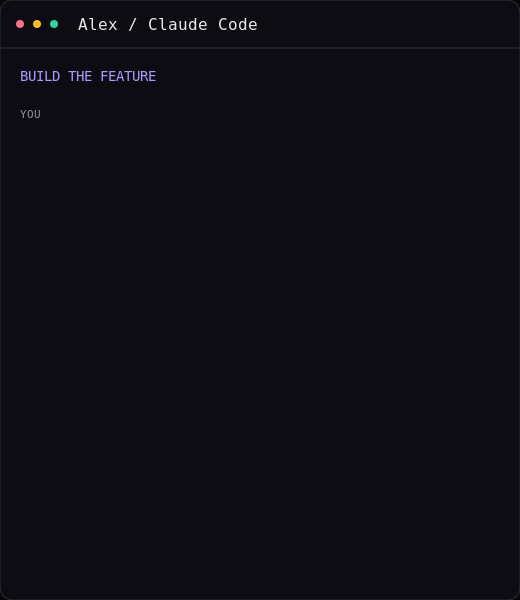

# Rekal — Git-backed memory for AI coding agents

**Carry the context forward.**

Ask your agent to Rekal context from your team and past work for the task at hand.
Across sessions, agents and teammates—with the original sources ready to read.
Captured with commits. Searchable locally. Shared through Git.

One binary. Local embeddings by default. No hosted memory account required.

[](https://rekal.dev)
[](https://rekal.dev/#downloads)
[](https://github.com/rekal-dev/rekal-cli/releases)
[](https://github.com/rekal-dev/rekal-cli/actions/workflows/ci.yml)
[](https://arxiv.org/abs/2607.14390)
[](LICENSE)
[](https://discord.gg/hDMj8zHH2)
[](https://github.com/rekal-dev/rekal-cli/stargazers)

[Get started](#quick-start) · [Documentation](#documentation) · [Website](https://rekal.dev)

## Get context. Then get to work.

[](https://rekal.dev/#demo)

Your agent finds relevant context from your team and past work, reads the
sources and uses what matters for the job.

**Agents own the reasoning. Rekal makes the context durable, retrievable and shared.**
As agents improve at memory and distillation, they can do more with the project
record you already have. [Core principles](SOUL.md#the-core-bet-enable-the-agent).

Works with **Claude Code, Cursor, Copilot, Codex, Gemini, Kiro and OpenCode**.
Claude project notes are captured by default; other note sources are configurable.

## Quick start

### From a shell

```bash
curl -fsSL https://rekal.dev/install.sh | bash
export PATH="$HOME/.local/bin:$PATH"
rekal version
cd your-project
rekal init
```

The installer gets the **latest release** and verifies its checksum.
Supports macOS ARM64, Linux AMD64 and Linux ARM64.
The PATH line is for Bash/Zsh; in Fish, use `fish_add_path "$HOME/.local/bin"`.

Work with your agent, then commit normally to capture the context.
Already have local sessions? Run `rekal checkpoint`. For shared team history,
run `rekal sync`. Then ask your agent about your actual project—the example
above shows the pattern. An empty history will have nothing to recall.

### From Claude Code

```text
/plugin marketplace add rekal-dev/rekal-cli
/plugin install rekal@rekal-dev
```

Run `/rekal:install` once per machine and `/rekal:init` in each repository,
then work and commit as usual.

Rekal stores context locally. Eligible project records can be shared through
your Git remote; explicitly local notes stay local.
[Setup and sharing details](docs/overview.md) · [Privacy and security](SECURITY.md)

## Documentation

- [Using Rekal](docs/usage.md) — setup, capture and team workflows
- [Search and memory](docs/overview.md) — source reads, native notes and sharing
- [Commands](docs/commands.md) · [Configuration](docs/configuration.md)
- [Design principles](SOUL.md) · [Benchmarks](docs/research/benchmarks.md)
- [Development](docs/DEVELOPMENT.md) · [Contributing](CONTRIBUTING.md)

[Get help](https://github.com/rekal-dev/rekal-cli/issues) ·
[Changelog](CHANGELOG.md) · [Paper and citation](docs/overview.md#citation)

Apache-2.0 — see [LICENSE](LICENSE).
