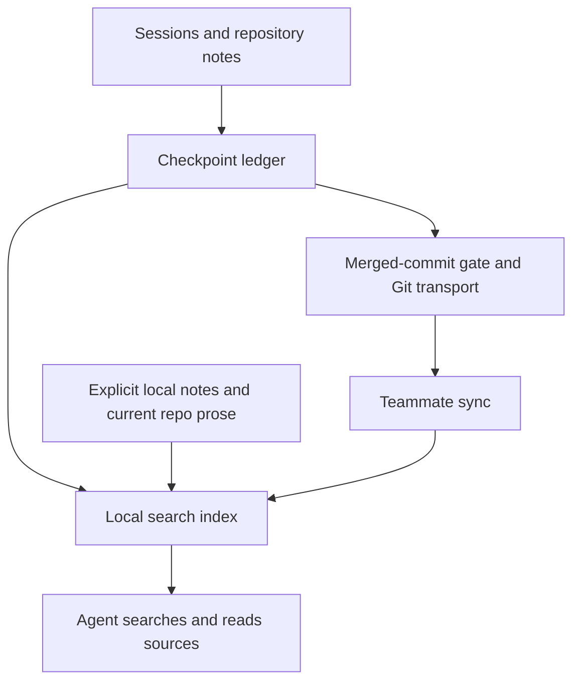

# Rekal — Git-backed memory for AI coding agents

**Carry the context forward.**

Your project’s memory, across sessions, agents and teammates.
Rekal makes past coding
conversations and project notes searchable across Claude Code, Codex and your
team—with the original source ready to read. Captured with commits. Searchable locally. Shared through Git.

One binary. Local embeddings by default. No hosted memory account required.

> **Rekal 2.0 is available.** [Download v2.0.1](https://github.com/rekal-dev/rekal-cli/releases/tag/v2.0.1)
> for native project memory and the unified search/read interface.
> Coming from 1.x? Read the [upgrade guide](docs/upgrading.md) before migrating.

> **Linux compatibility:** v2.0.1 targets Ubuntu 24.04 / GLIBC 2.39 or newer,
> with the standard C++ and OpenMP runtimes. Older GLIBC and musl systems need a
> [source build](docs/DEVELOPMENT.md). Upgrade from v2.0.0 on Linux AMD64 to
> remove its unintended GLIBC 2.43 requirement.

[](https://rekal.dev)
[](https://github.com/rekal-dev/rekal-cli/releases)
[](https://github.com/rekal-dev/rekal-cli/actions/workflows/ci.yml)
[](https://arxiv.org/abs/2607.14390)
[](LICENSE)
[](https://discord.gg/hDMj8zHH2)
[](https://github.com/rekal-dev/rekal-cli/stargazers)

[Get started](#quick-start) · [Search and read](#search-and-read) ·
[Native memory](#native-memory) · [Team memory](#team-memory) ·
[Benchmarks](#benchmarks) · [Upgrade](#upgrading) · [Docs](#documentation)

## Why Rekal

- **Resume earlier work.** Recover constraints, attempted fixes and rejected
  alternatives before repeating the investigation.
- **Change agents, keep context.** Make captured project history available to the
  next supported coding tool, even when another agent produced it.
- **Bring teammates up to speed.** Share eligible records through your Git remote;
  each teammate searches a local index.
- **Follow the evidence.** Read captured conversation passages and attributed note
  revisions. Compare historical reasoning with current project files and tests.

## A decision should survive the handoff

Yesterday, Dana and Claude Code rejected fixed-delay webhook retries: they made
failing deliveries arrive together. Today, Sam opens Codex to change the retry
logic. The code shows jitter. Rekal helps recover **why it is there**.



1. **Keep the decision.** Commit normally. Rekal checkpoints supported sessions
   and project notes; eligible records travel after merge and push.
2. **Find it again.** Sam runs `rekal sync`, then
   `rekal "why do webhook retries use jitter?"`. Search returns conversation
   leads and matching notes.
3. **Read before changing.** Copy a returned reference into
   `rekal query --ref <returned-reference>`. Inspect the original reasoning,
   then check the current implementation and tests.

*This is an illustrative scenario with synthetic content and abbreviated results,
not a recorded CLI run. A note does not automatically link to the exact
conversation that produced it.* [Try the interactive walkthrough](https://rekal.dev).


Session adapters support **Claude Code, Cursor, Copilot, Codex, Gemini, Kiro and
OpenCode**. Native note discovery defaults to **Claude project memory**; other
Markdown sources require configuration. Session capture and note discovery are
separate capabilities.

## Quick start

### From a shell

```bash
curl -fsSL https://raw.githubusercontent.com/rekal-dev/rekal-cli/main/scripts/install.sh | REKAL_VERSION=v2.0.1 bash
cd your-project
rekal init
# Work and commit normally. The hook captures supported sessions.
rekal "why do webhook retries use jitter?"
```

Supported release targets: macOS ARM64, Linux AMD64 and Linux ARM64. Historical
releases are approximately 170 MB to download: the embedding model, database and
inference engine ship together. No separate model download or database service.

[Inspect the installer](scripts/install.sh) or download an archive and
`checksums.txt` from [Releases](https://github.com/rekal-dev/rekal-cli/releases).
Set `REKAL_VERSION` on the **bash process**, as above, to skip latest-version API
lookup. Source builds require the native dependencies in the
[development guide](docs/DEVELOPMENT.md); `go install` alone is insufficient.

### From Claude Code

```text
/plugin marketplace add rekal-dev/rekal-cli
/plugin install rekal@rekal-dev
```

Run `/rekal:install` once per machine and `/rekal:init` in each repository.
The plugin handles setup; the binary installs the version-matched recall skill.

`rekal init` creates local storage and Git hooks, installs the agent skill, and
adds a marked pointer to supported agent instruction files. Re-run it after
upgrading to refresh hooks and instruction pointers without deleting data.
See [setup and removal](docs/usage.md) for exactly what changes.

## Search and read

The everyday interface is deliberately small:

| Task | Command |
|---|---|
| Find context | `rekal "why do webhook retries use jitter?"` |
| Read a source | `rekal query --ref <returned-reference>` |
| Continue | Follow the returned `more:` command |
| Programmatic output | Add `--json` |

Search returns ranked conversation leads, matching memory notes, current prose
pointers and paginated literal conversation matches. Read the source you need
rather than loading every session. The agent decides what matters.

References identify sources, not generated answers. Notes can be wrong, and a
historical decision does not prove what today's code does. A note reference does
not automatically identify the exact conversation that caused the agent to write it.

Short handles such as `s14` are local conveniences; use canonical references for
citations. A ranked result's default reference opens its first anchor. Advanced
`rekal evidence` can combine multiple anchors. Search continuations and source
continuations are separate; copy the printed command.

<details>
<summary>Advanced retrieval and administration</summary>

Use `rekal find <query> [--json]` for explicit literal conversation search.

Filters, session queries, `evidence`, SQL, index rebuilds and embedding
administration remain available. They are not required for ordinary memory use.
Read the [command guide](docs/commands.md) and
[read contract](docs/spec/command/query.md) when you need them.

</details>

## Native memory

**Your agent writes the notes. Rekal keeps the trail.**

Claude project memory is discovered at checkpoint time by default. The first
successful scan records the existing notes as a baseline; later scans append
changed revisions or deletion markers. Rekal does not intercept distillation or
write back to native files.

| Source | Retention | Sharing |
|---|---|---|
| Captured conversations | Checkpoint ledger | Eligible records through Git |
| Repository notes | Observed revisions in the ledger | Same export gate as conversations |
| Explicit local notes | Current snapshot in the local index | Never exported |
| Current repository prose | Derived local index at HEAD | Ordinary code Git workflow, not Rekal frames |

Personal/account-wide sources are opt-in. A local snapshot can be rebuilt only
while its native file remains available; it is not a private historical archive.
Custom Claude memory directories require an explicit path.

Set `"memory": false` in `.rekal/config.json` to stop new native capture and local
note indexing. This does not erase retained or published repository history.
[Configuration, identity, timestamps and boundaries](docs/design/native-memory.md).

### Claude Code memory, Claude-mem and Rekal

Claude Code has native instructions and working notes. **Claude-mem** is a
separate open-source project with an observation-processing workflow. Rekal
focuses on a Git-backed project record and original evidence across agents.

Use Rekal when another agent or teammate needs to recover reasoning through the
repository workflow. Your existing memory may be enough if that need is already
covered. Rekal does not provide bidirectional sync with Claude-mem or Mem0;
native Claude note capture is not a Claude-mem database integration.

[Claude Code memory guide](https://rekal.dev/claude-code-memory) ·
[Rekal vs Claude-mem](https://rekal.dev/compare/claude-mem) ·
[Git-backed team memory](https://rekal.dev/git-agent-memory)

## Team memory

1. **Commit:** the hook checkpoints supported sessions and repository notes.
2. **Push:** eligible records travel on a separate `rekal/<email>` orphan branch.
3. **Sync:** teammates run `rekal sync`, then search their local index.

Your product branch and code-commit messages stay intact. Neither `data.db` nor
`index.db` is uploaded as a database file; transport contains compressed records.
Indexes, embeddings and personal recall signals remain local.

Export eligibility follows merged-commit association, including ancestry and
squash-merge patch equivalence. **This is not a sentence-level privacy filter.**
A captured session or note may contain context beyond the merged work. Review
source scope and remote access before sharing.

Redaction and path anonymization run before storage, but are best effort. Git
push sends eligible context to your remote. An explicitly configured HTTP
embedding backend receives text. Rekal CLI has no usage telemetry.
See [SECURITY.md](SECURITY.md) and [usage](docs/usage.md).

## How it works



Thin on the wire, rich on the machine. Retained history is the record; the local
index is a rebuildable search structure. The installed skill orients the agent
without prescribing its conclusions. [Design principles](SOUL.md).

## Benchmarks

These are **previously reported results**, not a fresh evaluation of v2.0.0 or a measured old-versus-new release comparison. The historical answering
agent was GPT-5 Sol. Different reader models, judges, samples and context budgets
prevent a direct ranking against other projects' published scores.

| Historical benchmark | Reported answer accuracy | Reported Recall@20 | Context tokens/query | Agent turns/query |
|---|---:|---:|---:|---:|
| LoCoMo | 90.57% | 98.61% | ~7.5K | 5.9 |
| LongMemEval | 86.60% | 99% | ~10.5K | 6.6 |

LoCoMo also reported Recall@10 of 93.60%, Recall@5 of 86.44%, and answer F1 of
63.0. Answer scores, retrieval recall and evidence coverage are separate metrics.
See the [run procedure](docs/research/RUN.md) and [benchmark harness](scripts/bench/).
These historical runs did not evaluate native memory integration.

**2.0 development evidence diagnostic (14 November 2026):** on a 400-question LoCoMo
sample, multiple passages delivered every annotated supporting turn for 54.50%
of questions; passages plus extractive notes reached 56.25%, using 17.9% more
source text. This is **complete evidence coverage, not answer accuracy**. It used
no answering model, judge or Claude distillation. The session-primary control
was a simulation, not a v1.0.2 binary execution. [Results, tested commit and limits](docs/research/runs/2026-11-14-locomo-memory/README.md).

**Local store, wire & recall latency** (Rekal's own coding sessions, Apple M4 —
6 Claude transcripts / 14 sessions, 473 turns; pure `rekal`, no answering model):

| Metric | Result |
|---|---|
| Raw JSONL | 8.5 MB |
| Wire | 54 KB (**~158×**) |
| `data.db` | 5.8 MB |
| `index.db` | 10.8 MB |
| Local store (`data` + `index`) | 16.5 MB |
| Recall latency | median **~150 ms** (p95 ~210 ms) |
| LoCoMo synthetic recall | median ~350 ms (p95 ~400 ms) |
| In-process search | ~76 ms |

The footprint and latency rows above are historical measurements on the named
corpus and machine, not guarantees for every repository or the current release
candidate. Wire reduction compares encoded transport with raw transcript files;
local databases retain richer search structures.

Checkpoint currently performs some embedding work synchronously. Large native
transcripts can make a commit hook slow. Background `rekal embed` fills missing
vectors after index/sync; it does not make checkpoint latency disappear.

## Upgrading

**v2.0.0** ships the search/read interface and native project memory.
Install the release above, then follow the migration steps before using an existing store.

Follow the [upgrade guide](docs/upgrading.md). No force push or code-commit
rewrite is required. Upgrade **every writer** of memory-bearing branches.
Reindexing repairs derived state; it cannot recover deleted native notes or
records dropped by an incompatible older writer. Back up unpublished ledger
records before migration. `rekal clean` removes the local store; it is not an
upgrade command.

## Documentation

| Guide | What it covers |
|---|---|
| [Usage](docs/usage.md) | Setup, capture, sharing, worktrees and progressive reads |
| [Configuration](docs/configuration.md) | Local settings, ranking and embedding backends |
| [Native memory](docs/design/native-memory.md) | Source scope, revisions, timestamps and privacy boundaries |
| [Upgrading](docs/upgrading.md) | Forward migration, writers, references and reindexing |
| [Compatibility](docs/compatibility.md) | Store, wire, flags and exit-code guarantees |
| [Changelog](CHANGELOG.md) | Release status and changes |
| [Research](docs/research/) | Evaluation methods, harnesses and dated results |
| [Development](docs/DEVELOPMENT.md) | Build, test and release |
| [Contributing](CONTRIBUTING.md) | Review criteria and required checks |

Current usage describes main. Research papers and dated experiments record their
own scope; they are not current feature promises. Read [SOUL.md](SOUL.md) before
contributing. For help, run `rekal --help` or open an
[issue](https://github.com/rekal-dev/rekal-cli/issues). Report vulnerabilities
through [SECURITY.md](SECURITY.md).

## Citation

If you use Rekal or build on the research, please cite the paper:

```bibtex
@misc{guo2026rekal,
  title         = {Why Git Is the Memory Solution for the Agentic Development Lifecycle},
  author        = {Guo, Frank},
  year          = {2026},
  eprint        = {2607.14390},
  archivePrefix = {arXiv},
  primaryClass  = {cs.SE},
  url           = {https://arxiv.org/abs/2607.14390}
}
```

## License

Apache-2.0 — see [LICENSE](LICENSE).
