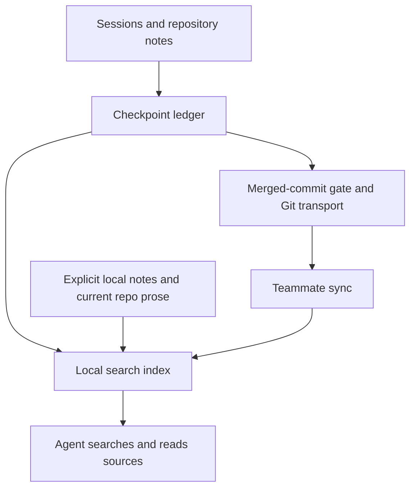

# Search, memory and sharing

[Back to the quick start](../README.md#quick-start) · [Full usage guide](usage.md)

## Search and read

The everyday interface is deliberately small:

| Task | Command |
|---|---|
| Find context | `rekal "invoice export context"` |
| Read a source | `rekal query --ref <returned-reference>` |
| Continue | Follow the returned `more:` command |
| Programmatic output | Add `--json` |

Search returns ranked conversation leads, matching memory notes, current prose
pointers and paginated literal conversation matches. Read the source you need
rather than loading every session. The agent decides what matters.

References identify sources, not generated answers. Notes can be wrong, and a
historical decision does not prove what today's code does. A note reference does
not automatically identify the exact conversation that caused the agent to write it.

Short handles such as `s14` are local conveniences; use canonical references for
citations. A ranked result's default reference opens its first anchor. Advanced
`rekal evidence` can combine multiple anchors. Search continuations and source
continuations are separate; copy the printed command.

<details>
<summary>Advanced retrieval and administration</summary>

Use `rekal find <query> [--json]` for explicit literal conversation search.
Use `rekal embed` to fill missing embeddings after indexing or syncing.

Filters, session queries, `evidence`, SQL, index rebuilds and embedding
administration remain available. They are not required for ordinary memory use.
Read the [command guide](commands.md) and
[read contract](spec/command/query.md) when you need them.

</details>

## Native memory

**Your agent writes the notes. Rekal keeps the trail.**

Claude project memory is discovered at checkpoint time by default. The first
successful scan records the existing notes as a baseline; later scans append
changed revisions or deletion markers. Rekal does not intercept distillation or
write back to native files.

| Source | Retention | Sharing |
|---|---|---|
| Captured conversations | Checkpoint ledger | Eligible records through Git |
| Repository notes | Observed revisions in the ledger | Same export gate as conversations |
| Explicit local notes | Current snapshot in the local index | Never exported |
| Current repository prose | Derived local index at HEAD | Ordinary code Git workflow, not Rekal frames |

Personal/account-wide sources are opt-in. A local snapshot can be rebuilt only
while its native file remains available; it is not a private historical archive.
Custom Claude memory directories require an explicit path.

Set `"memory": false` in `.rekal/config.json` to stop new native capture and local
note indexing. This does not erase retained or published repository history.
[Configuration, identity, timestamps and boundaries](design/native-memory.md).

### Claude Code memory, Claude-mem and Rekal

Claude Code has native instructions and working notes. **Claude-mem** is a
separate open-source project with an observation-processing workflow. Rekal
focuses on a Git-backed project record and original evidence across agents.

Use Rekal when another agent or teammate needs to recover reasoning through the
repository workflow. Your existing memory may be enough if that need is already
covered. Rekal does not provide bidirectional sync with Claude-mem or Mem0;
native Claude note capture is not a Claude-mem database integration.

[Claude Code memory guide](https://rekal.dev/claude-code-memory) ·
[Rekal vs Claude-mem](https://rekal.dev/compare/claude-mem) ·
[Git-backed team memory](https://rekal.dev/git-agent-memory)

## Team memory

1. **Commit:** the hook checkpoints supported sessions and repository notes.
2. **Push:** eligible records travel on a separate `rekal/<email>` orphan branch.
3. **Sync:** teammates run `rekal sync`, then search their local index.

Your product branch and code-commit messages stay intact. Neither `data.db` nor
`index.db` is uploaded as a database file; transport contains compressed records.
Indexes, embeddings and personal recall signals remain local.

Export eligibility follows merged-commit association, including ancestry and
squash-merge patch equivalence. **This is not a sentence-level privacy filter.**
A captured session or note may contain context beyond the merged work. Review
source scope and remote access before sharing.

Redaction and path anonymization run before storage, but are best effort. Git
push sends eligible context to your remote. An explicitly configured HTTP
embedding backend receives text. Rekal CLI has no usage telemetry.
See [SECURITY.md](../SECURITY.md) and [usage](usage.md).

## How it works



Thin on the wire, rich on the machine. Retained history is the record; the local
index is a rebuildable search structure. The installed skill orients the agent
without prescribing its conclusions. [Design principles](../SOUL.md).

## Benchmarks

Historical evaluations with GPT-5 Sol reported **90.57% answer accuracy on
LoCoMo** and **86.60% on LongMemEval**. These runs predate native memory integration;
they are not current-release scores or head-to-head comparisons with other tools.

[Results and methodology](research/benchmarks.md) ·
[Benchmark harness](../scripts/bench/)

## Citation

If you use Rekal or build on the research, please cite the paper:

```bibtex
@misc{guo2026rekal,
  title         = {Why Git Is the Memory Solution for the Agentic Development Lifecycle},
  author        = {Guo, Frank},
  year          = {2026},
  eprint        = {2607.14390},
  archivePrefix = {arXiv},
  primaryClass  = {cs.SE},
  url           = {https://arxiv.org/abs/2607.14390}
}
```

