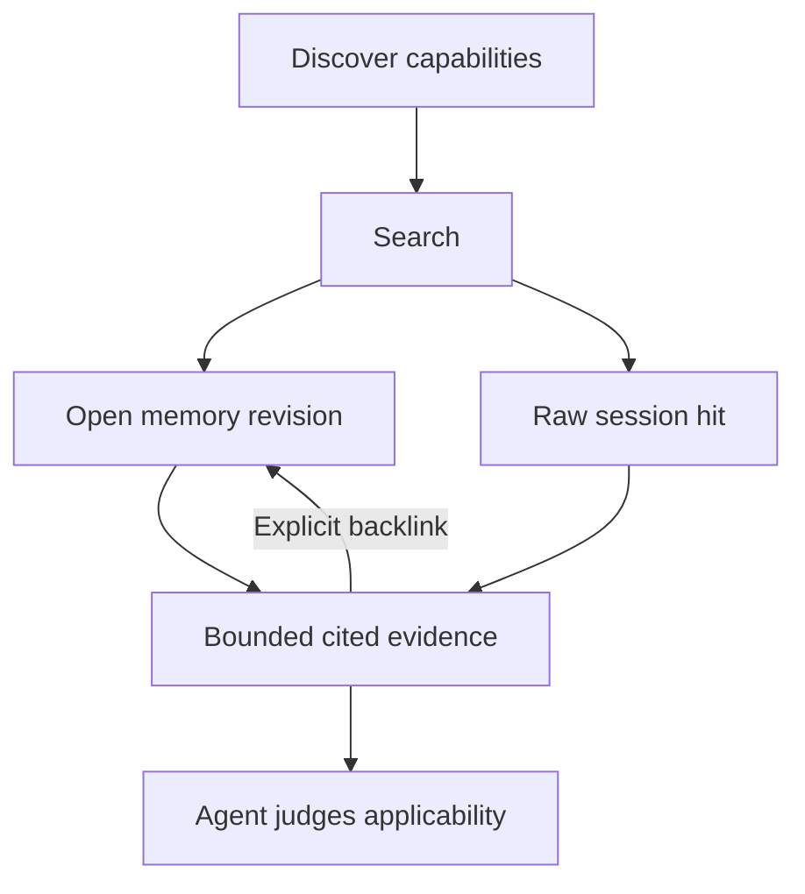

# Rekal memory frames: proof, consumer contract and scenarios

This is a local, synthetic proof of storing native-memory snapshots as a distinct frame inside the existing `rekal.body`, on the existing per-user Git branch. It extends the previous companion-file experiment. No production Rekal code, GitHub branch, tag, release or user memory was changed.

## Result and exact scope

- 11 new Go frame-contract tests pass, including two standalone/batch subtests.
- 34 Python consumer/transport scenario tests pass.
- 47 copied upstream codec tests pass unchanged.
- The codec, preset compression dictionary and `CommitWireFormat` Git writer come from upstream commit `16cc899274af026f8a8d6cf8216d391be9aa8489`.
- The memory record, consumer API and ranking experiments are prototypes. The full CLI, DuckDB pipeline, native adapters and production retrieval engine are not exercised.
- Old-client re-export is demonstrated with a known-record reconstruction model plus inspection of upstream `ExportAllFrames`, not execution of the full database export path.

`summary.json`, `go-tests.jsonl` and `consumer-tests.txt` contain the test evidence. `source_provenance.json` hashes the copied upstream files. The extra `codec/proof_extension.go` exposes opaque decompression for the new reader; the original codec files are unchanged.

## What the body proof establishes

The existing codec can encode an experimental `MemorySnapshot` member (`0x07`, not allocated upstream), standalone or in a batch. The memory envelope contains a version, a full checkpoint ID and an immutable snapshot record. Native file bytes are content-addressed and preserved; the checkpoint association is explicit and does not depend on neighboring frame order.

Existing session and checkpoint encodings stay unchanged. A checkpoint may have memory changes and zero session references. The capture integration must still be changed so this checkpoint actually runs when no session has changed.

The exact current Git writer preserves memory stored inside the body across subsequent writes. A local bare-remote push and fresh teammate clone preserve the body; the prototype consumer then searches a memory, opens its exact revision, and follows its citation to actual session text decoded from the same body.

Incremental append preserves existing bytes. A legacy reader skips the new member while decoding known session/checkpoint members. A legacy full re-export, however, rebuilds only known records and omits memory. An updated re-export must retain understood memory and refuse unsupported frame/schema versions. This does not retroactively protect a branch from an old executable. Mixed-writer deployment remains a release decision.

## Consumer journey

These are logical operations in the test model, not new CLI commands. Production integration should use the existing retrieval paths, with no mandatory handshake or prescribed sequence of calls. See [the integration boundary](../README.md#integration-boundary).



Capability discovery is logical contract negotiation. In Rekal it should normally ride the existing version-managed thin instruction route or command metadata, not become an extra network protocol or a mandatory extra call on every search.

1. **Discover:** know whether memory schema, memory fetch and evidence operations are supported. A consumer without support retains ordinary session search.
2. **Search:** return compact, separately labelled memory and session hits. Memory hits contain a canonical reference, snapshot ID, provenance, scope, available native timestamp, observation timestamp and a bounded snippet.
3. **Open:** retrieve the archived revision by canonical reference and snapshot ID. Do not read today's mutable native file for a historical hit.
4. **Follow:** parse explicit source citations and translate them mechanically into the current evidence-anchor grammar. The current emitted `SID:t42:bytes0-30` becomes `SID:42@0-30`. This bridge is implemented in the prototype, not patched into the production CLI.
5. **Read evidence:** apply scope again; deduplicate overlapping ranges; share one UTF-8 text-byte/slice budget across sessions; expose partial results and canonical continuation.
6. **Reverse hop:** a session passage can list memories explicitly citing it, with a limit. Each prototype operation performs one hop; it does not automatically traverse or recursively load a graph.
7. **Judge/adopt:** the agent decides whether the note still applies and whether to write anything to its own native memory. This proof performs no native write-back.

`example/consumer-journey.json` is a complete executed trace of this route. `example/rekal.body` and `example/dict.bin` use the actual upstream codec. The example commit hash is a synthetic placeholder; the fresh-clone integration test separately uses a real temporary Git commit.

## Ranking and configuration decision

Keep the current session ranking unchanged while introducing a separate memory result block. Rekal's existing knowledge layer already uses this additive pattern. Raw scores from unlike result types should not be mixed without calibration.

The prototype tests ranking mechanics with a simple lexical scorer and injected semantic fixture scores. It is deliberately not a BM25/LSA/vector implementation and proves no quality improvement. It establishes these invariants:

- Eligibility and ownership checks happen before scoring and again on fetch/evidence/backlinks. Changing weights cannot widen access.
- Native modification time and observation/import time have different meanings. Importing an old note does not make its contents newly learned. Unknown native time receives no invented freshness.
- Identical copies produce one search hit with multiple origins; copying does not accumulate confidence or relevance votes.
- Rank score is exposed as ranking information, not verified truth or confidence.
- Changing query-time weights does not change the archive or rebuild the index.
- Explicit zero settings are respected. Invalid, non-finite or all-zero retrieval weights are rejected by the prototype settings resolver.
- Missing semantic vectors preserve keyword fallback.
- Memory tuning or disabling its result block does not alter session ranking.
- Evidence budgets measure delivered original UTF-8 text bytes, not total JSON bytes or model tokens, matching the current evidence command's unit. Slice/anchor limits separately bound metadata.

For a first production implementation, reuse existing keyword/semantic controls and retrieval budgets. Keep any additional memory freshness/type boost neutral until evaluated. Avoid introducing a large set of persistent knobs. If memory controls are added, separate three concerns:

| Concern | Proposed ownership | What it cannot do |
| --- | --- | --- |
| Capture and sharing scope | Local owner-approved source policy | A repository's ranking config cannot authorize exporting personal memory |
| Ranking preferences | Existing machine defaults plus local repo overrides; request overrides only where supported | Cannot change evidence identity, history or visibility |
| Retrieval budget | Existing bounded fetch/evidence controls | Cannot claim an answer is correct merely because the budget is exhausted |

`consumer_model.settings()` demonstrates precedence using experiment-only key names. **Those keys are not proposed as shipped Rekal flags/config.** Current Rekal config uses its existing `weights` fields; the prototype API is an executable contract exercise.

## Decisions that remain before implementation

1. Choose capture defaults for private repo-native memory versus explicitly shared project memory. A note being about a repository is not sharing permission.
2. Define how onboarding discovers and imports native stores, including configured paths and already-initialized Rekal installations.
3. Persist checkpoint session extents before promising accurate historical raw-transcript retrieval. The prototype tests supplied extents; the current junction stores IDs only.
4. Integrate durable memory records into local storage, import, incremental export, re-export, checkpoint capture and index rebuild. Frames alone do not do this.
5. Decide mixed-writer support. An unknown-frame guard in a new version cannot constrain an old executable.
6. Evaluate latency, corpus growth, tokens-to-correct-answer and answer accuracy before changing ranking defaults.

Claude's repo-level auto-memory may span worktrees. A main-branch checkpoint is not evidence that every note was derived from merged work. The adapter should preserve actual source scope; a merged-only gate alone does not establish the provenance of every sentence in a cumulative note.

## Run

Requirements: Git, Python 3.11+, Go 1.25.6+. One Go module dependency is pinned: `github.com/klauspost/compress v1.17.11`, matching upstream.

```sh
cd harness
go mod download
go test -json ./... > ../go-tests.jsonl
go build -buildvcs=false -o ../frameprobe ./cmd/frameprobe
cd ..
python3 test_consumers.py
python3 demo_consumer.py
```

The source extraction is recorded against an exact upstream commit. Copied upstream files retain their upstream license (`UPSTREAM_LICENSE`). All experiment code is local proof code with no production wire-compatibility promise.

See `SCENARIOS.md` for the comprehensive acceptance matrix, including consumer handoffs, scope, configuration, failure behavior and cases still requiring integration or evaluation.
